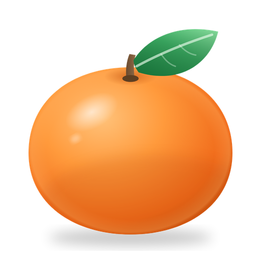
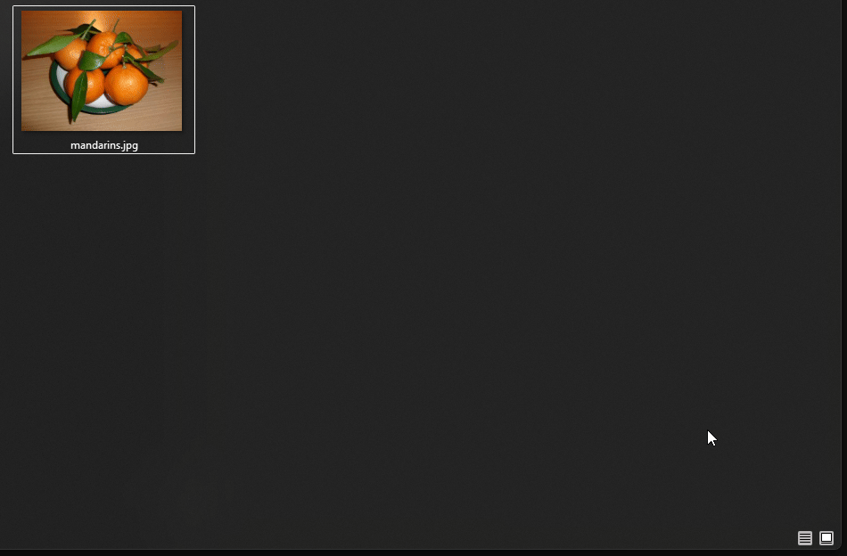
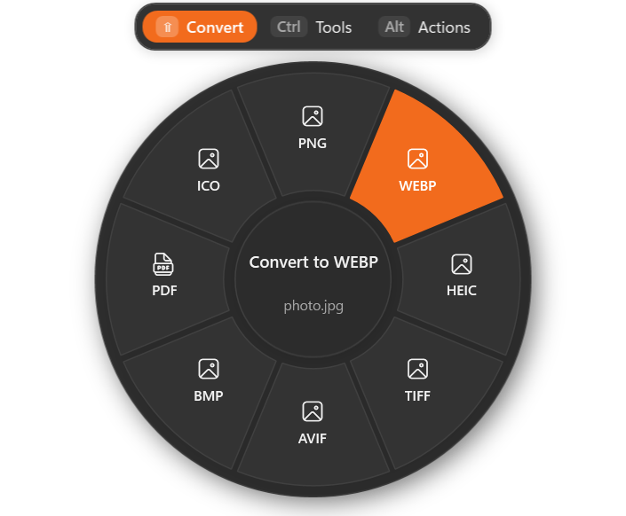
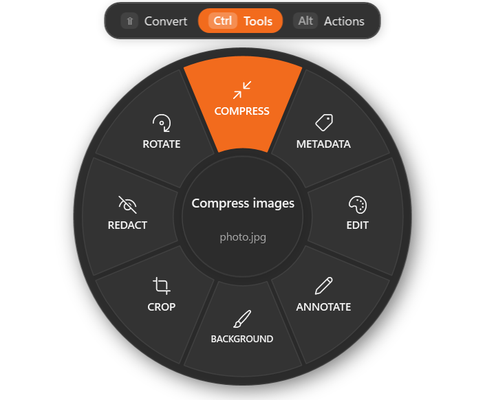
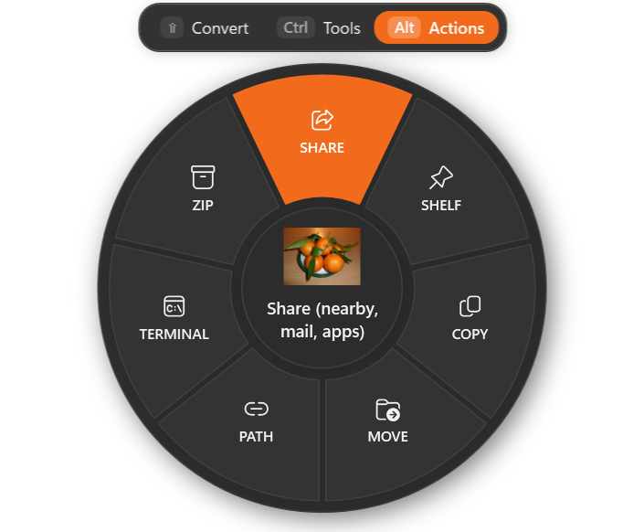
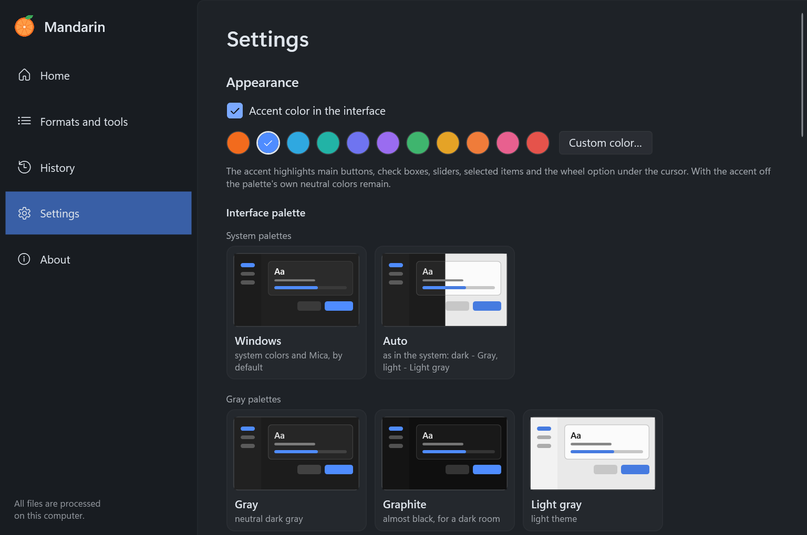
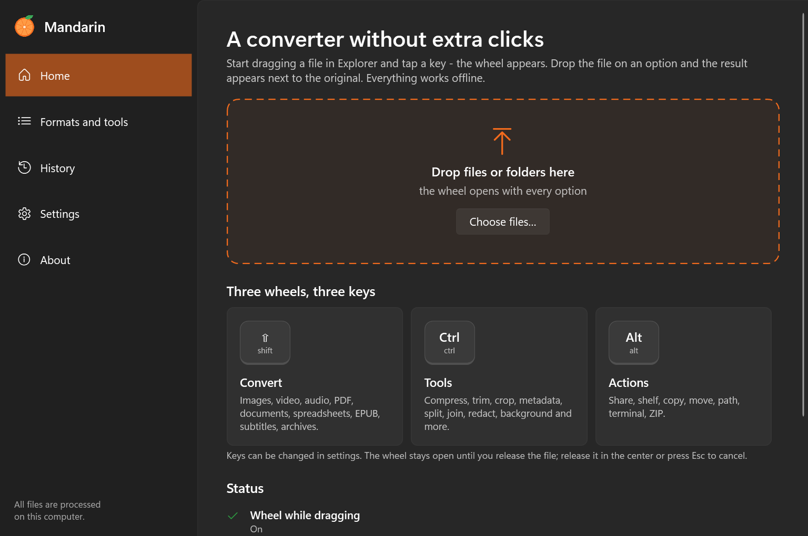
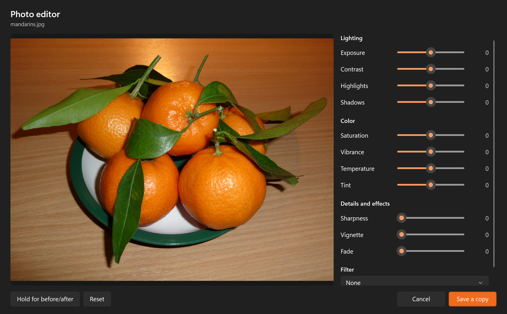
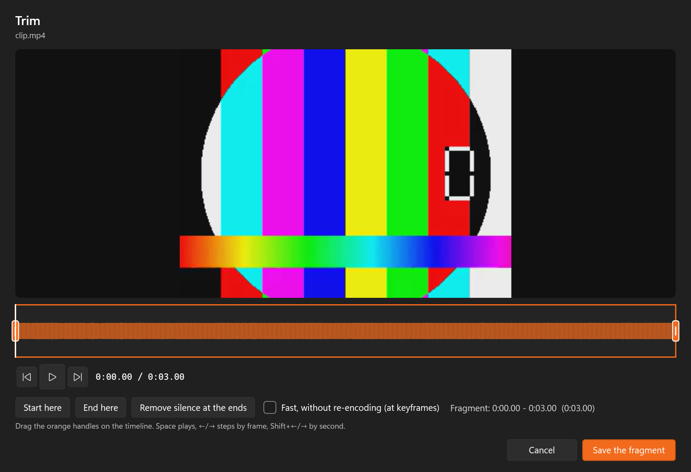
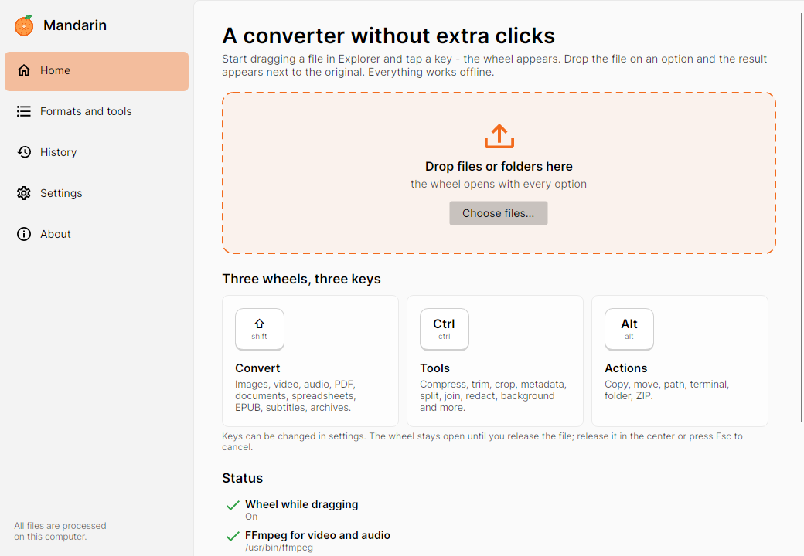

<p align="center">
  <a href="README.md">English</a> · <b>Русский</b>
</p>

<p align="center">
  
</p>

<h1 align="center">Mandarin</h1>

<p align="center">
  Офлайн-конвертер файлов для Windows 11 без лишних кликов – а также для Linux и Windows 7.<br>
  Начните тащить файл, нажмите клавишу, бросьте его на формат. Готово.
</p>

<p align="center">
  
</p>

## Как это работает

Начните перетаскивать любой файл или папку в Проводнике (или в любой программе, из которой можно
перетаскивать файлы) и, не отпуская кнопку мыши, **нажмите клавишу**. Под курсором откроется колесо.
Бросьте файл на нужный вариант, и результат появится рядом с оригиналом. Оригинал никогда не меняется.

| Клавиша во время перетаскивания | Колесо |
|---|---|
| **Shift** | Конвертация в другой формат |
| **Ctrl** | Инструменты: сжатие, кадрирование, обрезка, метаданные, разделение, склейка, скрытие, фон… |
| **Alt** | Действия: поделиться, полка, копировать, переместить, копировать путь, терминал, ZIP |

<p align="center">
  
  
  
</p>

Клавиши меняются в настройках. Чтобы отменить, отпустите файл в центре колеса или нажмите Esc.

Интерфейс анимирован целиком: колесо раскрывается сектор за сектором, вариант под курсором подсвечивается
и выдвигается наружу, карточки прогресса выезжают и сворачиваются, а страницы, карточки и кнопки
откликаются на мышь. Если в параметрах Windows выключены *Эффекты анимации*, Mandarin тоже их не показывает.

### Внешний вид

В **Настройки → Внешний вид** есть палитры интерфейса из LaserPrep – *Windows* (системные цвета и Mica, по
умолчанию), *Авто* (следует светлой или тёмной теме Windows), *Серый*, *Графит*, *Светлый серый*, *Сталь*,
*Бирюза*, *Сирень*, *Янтарь*, *Кофе* и *Бордо* – и акцентный цвет: фирменный мандариновый, ещё десять готовых
или любой свой. Акцент можно выключить, тогда остаются нейтральные цвета палитры. Всё перекрашивается сразу:
окна, колесо, карточки прогресса и заголовки окон.

<p align="center">
  
</p>

Если удобнее кликать, жест не нужен: бросьте файлы на окно Mandarin, выберите **Выбрать файлы
для конвертации…** в меню значка в трее или включите пункт **Отправить → Mandarin** в контекстном
меню Проводника.

## Возможности

### Конвертация

| Тип | Из | В |
|---|---|---|
| Изображения | JPG, PNG, WebP, HEIC, TIFF, AVIF, BMP, GIF, SVG, ICO, PSD, RAW | JPG, PNG, WebP, HEIC, TIFF, AVIF, BMP, PDF, ICO; GIF → MP4/WebM |
| Видео | MP4, MOV, MKV, WebM, AVI, WMV, M4V, FLV, MPG, 3GP, TS | MP4, MOV, MKV, WebM, AVI, WMV, GIF, MP3 |
| Аудио | MP3, M4A, WAV, FLAC, OGG, Opus, AIFF, WMA, AAC | MP3, M4A, WAV, FLAC, OGG, Opus, AIFF, WMA |
| PDF | PDF | DOCX, PPTX, XLSX, JPG, PNG, EPUB, TXT, Markdown, HTML (сканы через OCR Windows) |
| Документы | DOCX, DOC, ODT, RTF, Markdown, TXT, HTML | DOCX, ODT, PDF, TXT, Markdown, HTML, EPUB, PNG, JPG |
| Презентации | PPTX, PPT, ODP | PDF, JPG, PNG, PPTX |
| Таблицы | XLSX, XLS, ODS, CSV, TSV | XLSX, ODS, CSV, TSV, PDF |
| EPUB | EPUB | PDF, DOCX, ODT, TXT, Markdown, HTML |
| Субтитры | SRT, VTT | SRT, VTT, TXT |
| Архивы и папки | ZIP, TAR, GZIP, RAR, 7z, BZ2, XZ, папки | ZIP, TAR, GZIP |

### Инструменты

- **Изображения** – сжатие (пресет, процент или точный размер файла, при желании с уменьшением),
  метаданные EXIF и GPS, фоторедактор (экспозиция, контраст, света и тени, цвет, резкость, виньетка,
  фильтры), пометки (стрелки, фигуры, перо, маркер, текст, нумерованные выноски), фон (цвет, градиент,
  картинка или размытие; пропорции, отступы, скругление и тень), кадрирование (пропорции, точный размер,
  поворот, отражение), скрытие лиц и текста (распознаются локально средствами Windows), поворот,
  объединение в PDF, коллаж.
- **Видео** – сжатие (в том числе до нужного размера), метаданные, удаление звука, покадровая обрезка,
  кадрирование, скорость 0,25–4× с сохранением высоты звука, сохранение кадров в PNG, разделение на
  части, скрытие области на отрезке времени, склейка.
- **Аудио** – сжатие, теги, нормализация громкости (LUFS), видео с волной, обрезка с удалением тишины,
  моно/стерео, запикивание отмеченных фрагментов, склейка.
- **PDF** – сжатие (4 уровня), свойства, разделение, перестановка, поворот, дублирование и удаление
  страниц, объединение.
- **Архивы** – распаковка с защитой от выхода за пределы папки и от архивных бомб.

### Действия

Системное окно «Поделиться» (обмен с устройствами поблизости – аналог AirDrop), плавающая полка,
копирование в буфер обмена, перемещение в папку, копирование пути, открытие в Терминале, упаковка в ZIP.

<p align="center">
  
</p>

<p align="center">
  
</p>

<p align="center">
  
</p>

Скриншоты сделаны с английским интерфейсом; на русском он выглядит так же.

## Конфиденциальность и безопасность

- Всё работает локально. Изображения обрабатывает ImageMagick, видео и аудио – FFmpeg, PDF – встроенные
  средства Windows, PdfPig и PDFsharp, текст и лица распознаёт Windows. Ничего никуда не загружается;
  при печати HTML в PDF блокируются все сетевые запросы.
- Оригиналы никогда не меняются и не перезаписываются: результат всегда получает свободное имя
  (`photo.png`, `photo (1).png`, `photo (compressed).jpg`…). FFmpeg запускается с `-n`, архивы создаются
  в режиме `CreateNew`, а при ошибке удаляются только файлы, созданные самой задачей.
- Файл, брошенный на колесо, всегда копируется, а не перемещается.
- Распаковка никогда не выходит за пределы новой папки, не создаёт ссылки и устройства из TAR и
  ограничена свободным местом на диске минус 1 ГБ.
- HTML и Markdown встраивают только картинки из папки самого документа; абсолютные пути и `file://`
  заблокированы, удалённые картинки не скачиваются. XML из EPUB/ODT/ODS читается без DTD.
- Документы Office открываются с отключёнными макросами и без изменения ваших настроек Office;
  зависшие экземпляры Office, запущенные Mandarin, закрываются по тайм-ауту.
- Глобальные перехватчики ввода только наблюдают за мышью и клавишами-триггерами: ничего не
  блокируется, не записывается и не попадает в журнал.

## Linux и Windows 7/8

Есть отдельная сборка Mandarin для **Linux** (x64) и для **Windows 7 SP1 / 8 / 8.1** (x64). В ней те же
конвертации, инструменты и действия, колесо, карточки прогресса, палитры и значок в трее – на интерфейсе
Avalonia. Обе сборки самодостаточные: ставить .NET не нужно.

<p align="center">
  
</p>

Чем отличается от версии для Windows 10/11:

- **Жест перетаскивания** работает в Windows 7/8 и в сеансах X11 в Linux. Под Wayland система не даёт программам
  видеть клавиши, нажатые в чужих окнах, поэтому файлы открывают через **Открыть с помощью → Mandarin** в
  файловом менеджере (пункт включается в **Настройки → Интеграция с рабочим столом**), перетаскивают на окно
  Mandarin или выбирают в меню значка в трее. В колесе те же клавиши переключают режимы.
- **Страницы PDF** рисует встроенный PDFium. **Распознавание текста** в сканах и скриншотах – через
  [Tesseract](https://github.com/tesseract-ocr/tesseract), если он установлен; поиск лиц есть только в версии для
  Windows 10/11 (области отмечаются вручную).
- **PDF из документов** печатает LibreOffice или браузер на Chromium (Chromium, Chrome, Edge, Brave, Vivaldi)
  в фоновом режиме с отключённой сетью.
- **Предпросмотр видео и аудио** в обрезке, разделении, скорости и кадрировании показывает кадры, которые
  декодирует FFmpeg; звук играет `ffplay`, если он лежит рядом с FFmpeg.
- Нет окна «Поделиться» и полки; действия – копировать, переместить, копировать путь, терминал, показать в
  папке и ZIP.
- Настройки хранятся в `~/.config/Mandarin` в Linux и в `%APPDATA%\Mandarin` в Windows.

**Linux:** скачайте `Mandarin-<версия>-linux-x64.tar.gz`, распакуйте в любое место и запустите `./Mandarin`.
Нужны библиотеки X11 (`libx11-6 libice6 libsm6 libfontconfig1`, они есть в любом окружении рабочего стола) и
по желанию:

```bash
sudo apt install ffmpeg tesseract-ocr tesseract-ocr-rus libreoffice
```

Без композитора окон колесо рисуется на обычном прямоугольнике, а не парит над экраном.

**Windows 7/8:** скачайте `Mandarin-<версия>-win7-x64.zip`, распакуйте и запустите `Mandarin.exe`. Windows 7
нужен SP1 с обновлением *Universal C Runtime* (KB2999226, приходит с обычными обновлениями); сборка основана на
.NET 6 – последней версии .NET с поддержкой Windows 7. LibreOffice 24.8 – последняя версия для Windows 7 и 8.
Сборка проверена в Windows 11 и Linux, но не на настоящем компьютере с Windows 7.

## Требования

- Windows 10 2004+ или Windows 11, x64 (про Linux и Windows 7/8 – выше).
- [.NET 10 Desktop Runtime](https://dotnet.microsoft.com/download/dotnet/10.0) (не нужен для
  самодостаточной сборки).
- **FFmpeg** для видео и аудио: `winget install Gyan.FFmpeg`. Mandarin находит его сам, либо путь можно
  указать в настройках.
- **Документы, таблицы и презентации** – движок выбирается в настройках:
  - **Авто** (по умолчанию): Microsoft Office, если установлен → иначе LibreOffice → иначе встроенные
    конвертеры;
  - только **Microsoft Office** или только **LibreOffice** (если не установлен, используется встроенный);
  - **Только встроенный**: без внешних программ. Сохраняются текст, заголовки, списки, таблицы и
    картинки, но не точная вёрстка страниц; презентации и старые файлы DOC недоступны.

  LibreOffice бесплатен, его можно установить из настроек Mandarin (`winget`, около 1,5 ГБ). Mandarin
  запускает его со своим профилем и не трогает ваши настройки LibreOffice.
- Для сохранения в HEIC нужны *Расширения для изображений HEIF* и *Расширения для видео HEVC* из
  Microsoft Store.

## Языки

Интерфейс доступен на английском и русском. По умолчанию Mandarin следует языку интерфейса Windows;
язык меняется в **Настройки → Система → Язык**. Переводы лежат в
`src/Mandarin/Localization/<язык>.json` (ключи – английские строки), поэтому новый язык – это один
новый JSON-файл.

## Установка

1. Скачайте `Mandarin-<версия>-win-x64-framework-dependent.zip` со страницы
   [Releases](../../releases).
2. Распакуйте в любое место (например, `%LOCALAPPDATA%\Programs\Mandarin`) и запустите `Mandarin.exe`.
3. При желании включите на главном экране **Запускать Mandarin вместе с Windows**, чтобы колесо
   работало всегда.

Командная строка: `Mandarin.exe <файлы>` открывает колесо для файлов, `--background` запускает
программу только в трее, `--show` открывает главное окно, `--shelf` показывает или скрывает полку,
`--exit` закрывает запущенный экземпляр, а `--lang=Russian` (или `English`) задаёт язык интерфейса на
этот запуск, не меняя настройки.

## Сборка из исходников

```powershell
powershell -ExecutionPolicy Bypass -File build.ps1          # dist\Mandarin
powershell -ExecutionPolicy Bypass -File build.ps1 -Zip     # плюс архив для релиза
powershell -ExecutionPolicy Bypass -File build.ps1 -Linux -Zip   # dist\Mandarin-linux + .tar.gz
powershell -ExecutionPolicy Bypass -File build.ps1 -Win7 -Zip    # dist\Mandarin-win7 + .zip
```

Сборка для Linux и Windows 7 проверяет себя сама: `Mandarin --selftest <пустая папка>` конвертирует сгенерированные
файлы всеми доступными на компьютере движками и рисует каждое окно в PNG.

Самопроверка движков (создаёт тестовые файлы только внутри указанной папки):

```powershell
dotnet run --project tests\Mandarin.SelfTest -- C:\Temp\mandarin-test
```

Тот же инструмент рендерит скриншоты вне экрана (`-- <папка> ui`), записывает анимации вне экрана кадрами
и проверяет плавную прокрутку (`-- <папка> motion`), а также записывает кадры демо-GIF вместе с запущенным
Mandarin (`-- <папка> record`; около 15 секунд управляет мышью).

## Структура проекта

```
src/Mandarin
  Core/          настройки, определение типов файлов, матрица форматов, очередь задач, имена результатов, локализация
  Engines/       ImageEngine (Magick.NET), MediaEngine + Ffmpeg, PdfEngine (PdfPig, PDFsharp, Windows.Data.Pdf),
                 DocumentConverter, DocxReader, HtmlEngine (WebView2), EpubEngine, PptxWriter, SheetEngine,
                 SubtitleEngine, ArchiveEngine, OfficeEngine (COM / LibreOffice), WinRt (OCR, лица, HEIC)
  Interop/       глобальный жест перетаскивания (низкоуровневые хуки), миниатюры оболочки, окно «Поделиться»,
                 единственный экземпляр, автозапуск, «Отправить»
  UI/            колесо, карточки прогресса, главное окно, полка, окна инструментов
  Localization/  переводы интерфейса
src/Mandarin.Cross        сборка для Linux и Windows 7/8: интерфейс на Avalonia, те же движки (подключены из src/Mandarin),
                          Platform/ (PDFium, Tesseract, фоновая печать, жест для X11 и Windows, интеграция с рабочим столом)
tests/Mandarin.SelfTest   прогоняет все конвертации и инструменты на сгенерированных файлах
```

## Лицензия

[MIT](LICENSE). Сторонние компоненты перечислены в [THIRD-PARTY-NOTICES.md](THIRD-PARTY-NOTICES.md).

Фото на скриншотах –
[Citrus reticulata fruit 2009 G1.jpg](https://commons.wikimedia.org/wiki/File:Citrus_reticulata_fruit_2009_G1.jpg),
автор George Chernilevsky, общественное достояние, Wikimedia Commons.
